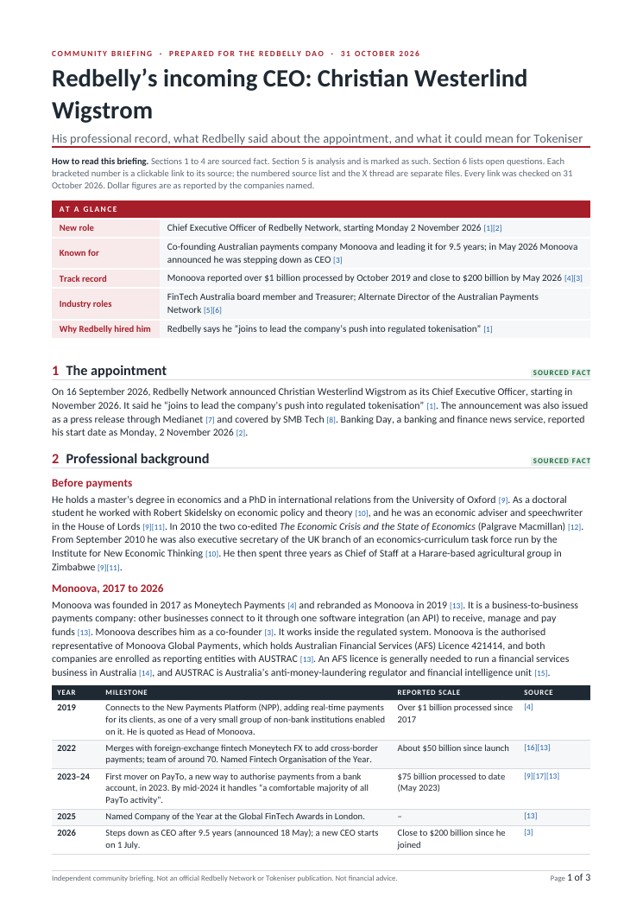
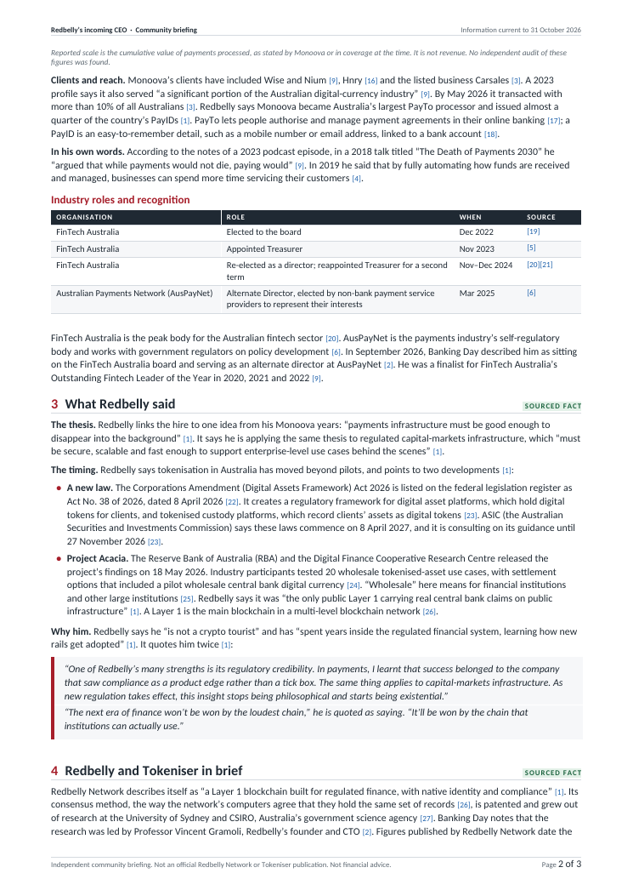
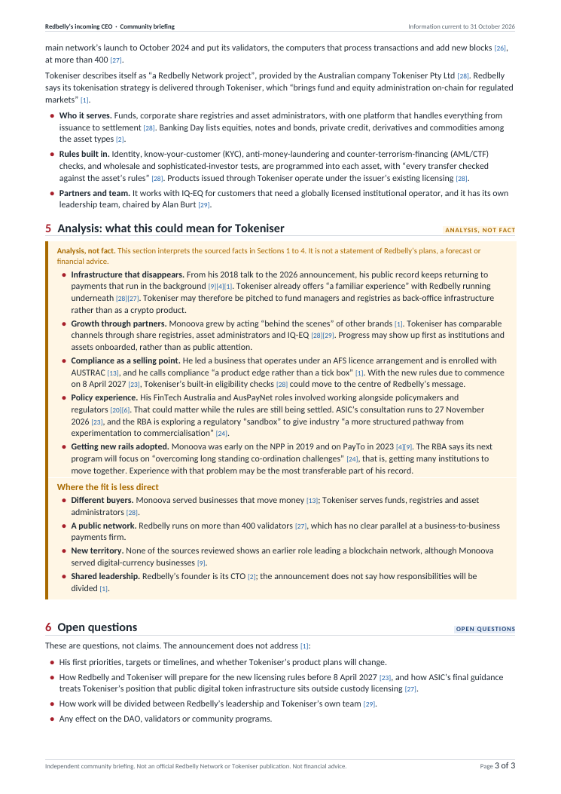

<div align="center">

<sub>COMMUNITY BRIEFING · PREPARED FOR THE REDBELLY DAO · INFORMATION CURRENT TO 31 OCTOBER 2026</sub>

# Redbelly’s incoming CEO

**A short, fully sourced briefing on Christian Westerlind Wigstrom: his professional record, what Redbelly said about the appointment, and what it could mean for Tokeniser.**


[**Read the briefing (PDF)**](briefing/redbelly-leadership-briefing.pdf) · [Word](briefing/redbelly-leadership-briefing.docx) · [Web version](briefing/redbelly-leadership-briefing.md) · [X thread](x-thread/x-thread.md) · [Source list](sources/source-list.pdf)

<br>

<a href="briefing/redbelly-leadership-briefing.pdf"></a>
<a href="briefing/redbelly-leadership-briefing.pdf"></a>
<a href="briefing/redbelly-leadership-briefing.pdf"></a>

</div>

---

## Deliverables

| # | Deliverable | Files | What it contains |
|:-:|---|---|---|
| 1 | **The briefing** (3 pages) | [PDF](briefing/redbelly-leadership-briefing.pdf) · [DOCX](briefing/redbelly-leadership-briefing.docx) · [Markdown](briefing/redbelly-leadership-briefing.md) | Six short sections: the appointment, his professional background, what Redbelly said, Redbelly and Tokeniser in brief, analysis, and open questions. Every citation is a clickable link to its source. |
| 2 | **X thread** (8 posts) | [PDF](x-thread/x-thread.pdf) · [x-thread.md](x-thread/x-thread.md) · [x-thread.txt](x-thread/x-thread.txt) | Ready-to-post copy blocks. Each post is within 280 characters by X’s counting rules and links to its own source. |
| 3 | **Source list** (29 sources) | [PDF](sources/source-list.pdf) · [sources.md](sources/sources.md) · [sources.csv](sources/sources.csv) · [claim-check.md](sources/claim-check.md) · [verification-report.md](sources/verification-report.md) | Every source with its link and date, a claim-by-claim table with a verbatim excerpt from each source, and the latest live check of every link and excerpt. |

The briefing PDF and DOCX are the same 3-page document. Every bracketed citation in them is a clickable link straight to the source, and the numbers match the source list.

## How the brief’s standards are met

| Standard in the brief | How this submission meets it | Checked by |
|---|---|---|
| Every factual claim has a working source link | 77 claims are mapped to 29 sources and 128 verbatim excerpts. Every paragraph, bullet and table row in Sections 1 to 5 carries a clickable citation. | `verify.py` (citations, links), `check_sources.py` (live links and excerpts) |
| Facts and analysis clearly separated | Sections 1 to 4 are tagged **SOURCED FACT**. Section 5 sits in an amber panel tagged **ANALYSIS, NOT FACT**, with a written disclaimer and a balancing list headed *Where the fit is less direct*. Section 6 is tagged **OPEN QUESTIONS**. The analytical thread post starts with “Analysis, not fact”. | `verify.py` (separation) |
| Readable without background knowledge | Each technical term is explained in plain words at first use, with its own source: API, AFS licence, AUSTRAC, NPP, PayTo, PayID, Layer 1, consensus, validator and wholesale. | Manual review |
| Neutral, professional tone | Claims are attributed (“Redbelly says…”, “Monoova reported…”). Company figures are labelled as self-reported and not audited. Analysis uses conditional language and sets out the counter-arguments. | Manual review |

| Failure criterion | Safeguard | Checked by |
|---|---|---|
| Unsourced claim, or a source that does not support it | Each claim is paired with a verbatim excerpt that is re-checked on the live page. Details that appear only behind a LinkedIn login were left out. | `check_sources.py`, [claim-check.md](sources/claim-check.md) |
| Private life, family or anything outside the professional record | Content is limited to roles, companies, publications, board seats and public statements. | `verify.py` (scope) |
| Invented or unsourced quotes | Every phrase in quotation marks, in the briefing and the thread, must match a source excerpt word for word (27 quotations checked). | `verify.py` (quotes) |
| Price talk, investment advice or promises of returns | There is no mention of prices, tokens or returns, and each page carries a “Not financial advice” footer. | `verify.py` (scope) |
| Unchecked AI-generated text, made-up facts or sources | Every source was opened and every fact matched to the text of its source. The check is repeatable by anyone with the scripts below. | `check_sources.py`, [verification-report.md](sources/verification-report.md) |
| Personal credit (names, handles, signatures, watermarks, “made by” lines) | There are no credits in any deliverable, and the DOCX and PDF author fields are empty. | `verify.py` (credit) |

## Method

1. **Start from the brief’s resources.** These were the Redbelly announcement, the Medianet release, the Banking Day and SMB Tech coverage, the public professional profile and the Tokeniser website.
2. **Go to primary sources for every fact.** These include Monoova and Cuscal releases, FinTech Australia board announcements, the Federal Register of Legislation, ASIC, the Reserve Bank of Australia and Australian Payments Plus.
3. **Record the evidence.** Each claim is written into [`data/claims.json`](data/claims.json) with the exact words from its source that support it.
4. **Keep fact and analysis apart.** Analysis only interprets facts already cited in Sections 1 to 4, and each analytical point is followed by the evidence it rests on.
5. **Re-check automatically.** The scripts confirm that every link opens and every excerpt is still on its page, and that the deliverables meet the brief’s rules.

**Notes on sources.** Banking Day is partly paywalled, and only its free preview is relied on. SMB Tech is cited only to show the appointment was covered; that site sometimes blocks automated checkers, so open it in a browser. The LinkedIn profile was reviewed but is not cited, because it needs a login: every claim rests on a page anyone can open. Payment volumes and network statistics are reported by the companies themselves.

## Verify it yourself

Python 3.9 or later, standard library only:

```bash
python3 scripts/verify.py
```

```bash
python3 scripts/check_sources.py
```

`verify.py` runs 54 offline checks covering sources, citations, links, quotes, the thread, fact and analysis separation, credit, scope, completeness and length. `check_sources.py` opens all 29 links and confirms all 128 excerpts. Add `--report sources/verification-report.md` to save the result. A GitHub Actions workflow runs the offline checks on every push and the live check weekly.

## Rebuild

Everything is generated from [`build/content.js`](build/content.js) (text) and [`data/`](data) (sources and claims), so the PDF, DOCX, Markdown, thread and source list never drift apart. Citation numbers are assigned automatically in order of first use.

Requirements: Node 18+, LibreOffice, Poppler and Python 3.9+.

```bash
npm install
```

```bash
npm run build
```

## Repository layout

```text
briefing/   redbelly-leadership-briefing.pdf | .docx | .md            ← deliverable 1 (3 pages)
x-thread/   x-thread.pdf | x-thread.md | x-thread.txt                 ← deliverable 2
sources/    source-list.pdf | sources.md | sources.csv | claim-check.md | verification-report.md   ← deliverable 3
data/       sources.json (29 sources) | claims.json (77 claims, verbatim excerpts)
build/      content.js (briefing and thread text) | build.js | build.sh
scripts/    verify.py (offline checks) | check_sources.py (live link and excerpt check)
assets/     page previews used in this README
```

## Corrections

If a source changes or a fact needs correcting, update `build/content.js` and `data/claims.json`, then run `npm run build` and `npm run check-sources`. Both checks must pass before the change is merged.

---

<sub>Independent community briefing. Not an official Redbelly Network or Tokeniser publication. Not financial advice. Information current to 31 October 2026.</sub>
